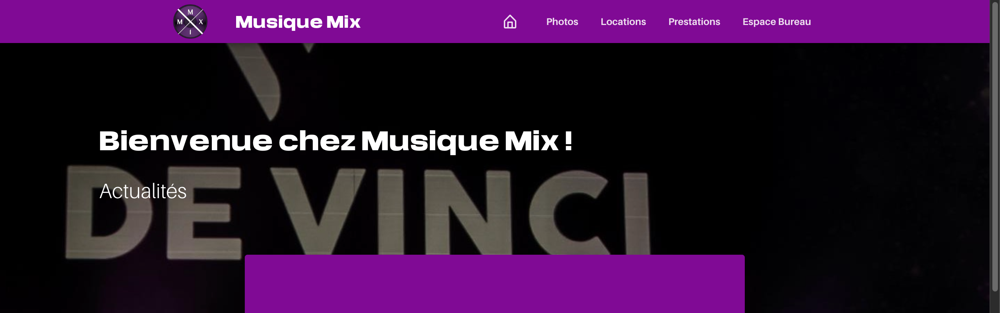

# MMX Website



## Project background

MMX Website was developed during my studies as part of my involvement with the Musique Mix association at Pôle Léonard de Vinci.

It reflects my technical skills and experience at that point in my development as a software engineer. Since then, I've continued learning, gaining experience, and improving my development practices, so some of the architectural choices and implementation patterns may no longer reflect how I would approach the same project today.

The platform was used in production during the 2024–2025 academic year before being discontinued due to a lack of ongoing maintenance capacity within the association.

The repository is now available as an open-source project for anyone interested in exploring or adapting it.

## Why this project exists

Musique Mix needed a digital presence that is:

- welcoming and visually engaging for visitors,
- easy to navigate for users looking for media, services, or rentals,
- flexible enough for staff to manage content and requests,
- secure enough for admin authentication and protected operations.

## Key features

- Home page and branded landing experience
- Photo gallery with categorized collections
- Rental management and request workflows
- Service/prestation request pages
- Administrative dashboard for managing users and content
- Backend API for secure data access and file handling
- Docker setup for a reproducible local environment

## Tech stack

- Frontend: Vue.js 3, Quasar, Vite
- Backend: Node.js, Express.js
- Database: MongoDB
- Media storage: Firebase Storage
- Authentication: bcrypt + JWT
- Containerization: Docker + Docker Compose

## Project structure

```text
MMX_Website/
├── backend/                 # Express API and backend services
│   ├── index.js             # Main API entry point
│   ├── package.json
│   ├── Dockerfile
│   └── .env.vault
├── frontend/                # Quasar + Vue frontend
│   ├── src/                # App pages, components, styles, routing
│   ├── public/             # Static assets and icons
│   ├── package.json
│   ├── Dockerfile
│   └── .env.vault
├── docker-compose.yml       # Full stack orchestration
├── .gitignore
└── README.md                # Project overview and setup
```

## Getting started

### Prerequisites

- Docker Desktop or Docker Engine
- Docker Compose
- Node.js 18 or 20 (optional for local non-container development)

### Run with Docker Compose

From the project root, start the whole stack:

```bash
docker compose up --build
```

This will launch:

- Frontend: http://localhost:9000
- Backend: http://localhost:3000

### Local development (without Docker)

Frontend:

```bash
cd frontend
npm install
npm run dev
```

Backend:

```bash
cd backend
npm install
npm start
```

## Environment configuration

The application expects environment variables for database and cloud storage access. In practice, the project uses files such as `.env.development` or `.env.vault` in the frontend and backend directories.

Typical backend variables include:

```env
MONGO_URI=your_mongodb_connection_string
VUE_APP_serviceAccountKey=your_firebase_service_account_json
VUE_APP_STORAGE_BUCKET=your_storage_bucket_name
```

If you are running locally, make sure the required secret/config files are present before starting the app.

## Usage

Once the app is running, users can:

- browse the homepage and featured content,
- view galleries and media collections,
- request equipment rentals,
- submit service or event-related inquiries,
- access the protected admin space for management tasks.

## Contributing

Contributions are welcome. If you want to improve the interface, extend the API, or add new management features:

1. Fork the repository
2. Create a feature branch
3. Make your changes
4. Open a pull request with a clear description

## Maintainer

This project is maintained by William RABOLIN.

## Notes

This repository is designed for a real-world association website and is a practical example of a full-stack app combining public-facing marketing content with internal administration workflows.
